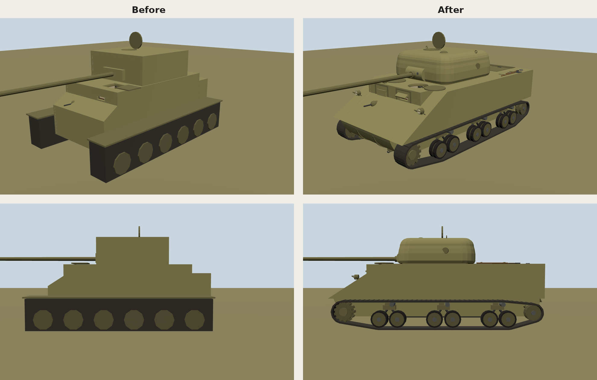

# The tank's outside

John's note (11 November 2026), once the driver could drive head out: the outside of the tank should look more like a tank and less boxy, and could the hatches be round?

Until now the outside was the cabin's own walls: a box hull with a box turret on it, tracks as two dark slabs and a row of plain wheels. From the convoy seat ([convoy-seat.md](convoy-seat.md)) the driver now sees the hull's front and the turret beside them, so the outside is built as an M4A4 Sherman's, the tank the inside already follows ([interior.md](interior.md), [crew-heights.md](crew-heights.md)).

## What changed

- **The hull** is a Sherman's: the upper hull widens into sponsons over the tracks, a long glacis runs down from the driver's hood to over the sprockets at the cabin's own 57° (the Sherman's 56°), with the rounded transmission cover, its bolted flanges and towing shackles under it, and the bow machine gun in its ball mount on the assistant driver's side. Behind the turret the A4's long engine deck carries the engine doors and grille, fuel caps and the pioneer tools, and the rear plate has the air cleaners, tail lights and a towing pintle.
- **The hoods**: the driver's and assistant driver's hoods stand proud of the glacis, as on early Shermans. The driver's visor is open over the vision slit; the assistant's is shut.
- **The running gear**: three vertical volute bogies a side, each with two pairs of road wheels on arms and a return roller on top, the drive sprocket at the front, the idler at the back, and a track of separate links with cleats running round them all.
- **The turret** is cast: a rounded oblong seen from above, its sides leaning in to a rounded-over roof edge, with the pistol port, the ventilator's dome, lifting eyes and a mantlet that is a half-round rotor round the gun with the coaxial gun and the sight's port in it. Its inside keeps its size and square plan; the roof's chamfers inside became rounded corners and edges, so the inside reads as cast too.
- **Round hatches.** The driver's hatch is round, 60 cm across, as a Sherman's. Its lid is a round plate that lies aside on its arm when open and plugs the hole when shut. The assistant driver's hatch on the right is round and shut. The gunner's hatch on the turret roof was round already.

The cabin inside is unchanged: walls, roof, seats, controls, slit, periscopes and sights are where they were, and the driver looks out of the slit at the same glacis. Only the turret's inside corners are rounded, by the 15 cm the chamfers took.

## Numbers

All in hull space (floor at y = 0, front towards −Z), in `src/sim/exterior.ts`.

| What | Value | Why |
| --- | --- | --- |
| Length | 6.82 m, nose −3.08 to the air cleaners 3.74 (hull 6.55 m) | An M4A4 is 6.06 m long; ours is built round a roomier cabin |
| Width over the sponsons | 3.28 m (`SPONSON.halfWidth` 1.64) | An M4A4's 2.62 m, widened as the cabin is |
| Sponsons' floor | 0.5 m, over the tracks' top (0.4 m) | Tracks run under them, as on a Sherman |
| Glacis | from 0.5 m at z −3.05 to the hood's face at 1.18 m, and to the deck over the sponsons at z −1.41 | The cabin's 57° slope, so the slit sees the same plate |
| Tracks | 42 cm wide (16½ in shoes), links every 15 cm, middle 1.41 m out | The Sherman's T48/T51 track |
| Road wheels | 52 cm across, two 9 cm wheels a pair | The Sherman's 20 in wheels |
| Bogies | middles at z −1.25, 0.45, 2.15; axles 28 cm either side | The A4's wider-spaced bogies |
| Sprocket, idler | sprocket at z −2.62 (radius 30 cm, 13 teeth), idler at 3.2 (24 cm) | Drive at the front, idler behind |
| Turret | 2.44 m across, 1.22 m ahead of the ring's middle and 1.3 m behind, corners rounded 40 and 42 cm, roof edge 28 cm | A cast turret's lines, 74% of the hull's width as on a Sherman |
| Turret's foot | 4.5 cm over the deck | Clears the shut hatches' lids (3 cm) as it sweeps over them |
| Turret's reach | 1.61 m from the ring's middle | No further than the square turret's corners did (1.62 m): clear of the driver's open lid, its post and the driver's periscope |
| Driver's hatch | round, radius 30 cm, middle 4 cm ahead of the convoy eye (z −1.42) | A Sherman's round hatch |
| Head out | the head moves 15 cm left and right, 20 cm forward and 12 cm back before the neck is 8 cm from the rim | The square hatch gave 17 left and right, 22 forward and 10 back |

## What else it touches

- **The footprint that meets obstacles** (`FOOTPRINT`, src/sim/tank-drive.ts) is now the outline the tank is drawn with (`OUTLINE_EXTENT`): 1.64 m either side (1.8 before), front −3.08 (−3.0) and rear 3.74 (2.6). The tank is drawn longer behind, so backing into a wall stops it sooner than before. The tracks' gauge, and so the steering, are unchanged.
- **The driver's turret dial** draws the hull at the new width and length.
- **The cabin's light** (`insideCabin`, src/sim/interior.ts, and the shader in src/scene-assets/cabin-light.ts) tests the turret's inside as a box with rounded corners, so the lighting follows the new corners.
- **Frame time**: the outside is one more mesh in the hull (`Hull Outside`, about 10,000 triangles) with the hull's own material, so one more draw call; the turret's shell stays in the turret's mesh.

## Tests

- `test/exterior.test.ts`: nothing on the hull's outside inside the cabin, whatever way the turret is turned; the whole tank inside the footprint and filling it; the proportions; the track flat on the ground, under the sponson and inside its width; the road wheels clear of one another, the sprocket and the idler; the turret's shell clear of its inside all round so it is lit as outside; the roof's flat top holding the hatch; the turret sweeping clear of the driver's open lid, its post and the periscope, and over both shut lids; the head box in the convoy seat 8 cm inside the round hatch's rim at every corner.
- `test/z-fighting.test.ts`: the hull with its new outside and the turret with its shell, at the world's 8 mm and the cabin's 3 mm.
- `test/interior.test.ts`, `test/convoy-seat.test.ts`: the head boxes, the lid aside and the periscope as before, measured from the new meshes.

## Headset check

1. Enter VR alone. Game menu (Y) → **Practice → Drive the tank → Head out**. Look forward and down: the long glacis, the hoods, the bow gun, the headlights and the sponsons over the tracks. Look right and back: the turret's rounded side and the deck.
2. Look at the hatch's rim round you and the lid lying open on your left: both round. Move your head about: the view should fade only as your neck comes near the rim, all round.
3. Drive off: the tracks and wheels don't move (they are drawn still), so say whether that spoils it from the convoy seat.
4. Head out again to sit down. Look out of the slit: the glacis and view are as before.
5. As gunner (with the practice crewmate driving), open the periscope and turn it round: the hull's deck, the driver's hatch and the sponsons from above. Traverse the turret right round: it turns over both shut hatches.
6. Note the perf HUD's frame time head out.

Report: whether it looks like a Sherman from the hatch, anything that looks wrong or flickers, and whether moving tracks and wheels are wanted.
