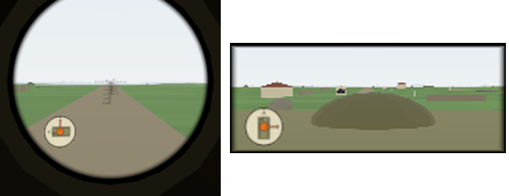

# Hull direction in the gunner's sights (F2.4)

A small round mark in the lower left of the gunsight's view, and the same in the gunner's periscope, shows where the hull is pointing from where the gunner looks. It is the driver's turret dial ([turret-dial.md](turret-dial.md), F2.3) seen from the other seat: the same cream face, olive hull and orange turret-and-gun pointer, but the way the gunner looks stays at the top and the hull turns under it. With the turret round to 3 o'clock and a target in the sight, the gunner sees the hull's nose at 9 o'clock on the mark, so "driver, left" turns the hull towards the gun. The numbers live in [`src/sim/hull-direction.ts`](../src/sim/hull-direction.ts); the lens's shader draws the mark ([`src/systems/scope-lens.ts`](../src/systems/scope-lens.ts)) and [`src/systems/hull-direction-system.ts`](../src/systems/hull-direction-system.ts) paints its texture and turns it.

## What players experience

- **In the gunsight.** Lean in and the mark is in the lower left of the round field, clear of the reticle and its range marks. The orange gun always points up, as the sight looks along it; the hull turns under it as the turret traverses, an arrowhead at its nose. Turret to the right, the hull turns left: at 3 o'clock its nose points to 9, at 6 straight down.
- **In the gunner's periscope.** The same mark in the lower left of the window. A notch at the top of the rim marks where the periscope looks; the hull turns by the turret's angle plus the periscope's, and the gun by the periscope's alone. Turn the periscope away from the gun and the gun pointer swings off the notch, so the gunner sees both how to tell the driver and which way to traverse.
- **The mark is part of the picture**, drawn at infinity like the reticle, so it is sharp with the eye focused on the view and both eyes see it in the same place. A closed lens shows no mark.
- **Sights → Hull in sights → On / Off** shows or hides it in both lenses at once (kept with the other settings).
- **Sights → Hull outline → Turret to 3 / Turret to 7** (the game menu's Sights tab) put the player at the gunsight (alone, in the gunner's seat) and turn the turret there by itself at the power traverse's rate, with a sign saying where the nose should end up. **Forward** turns it back.

## Numbers

| What | Value | Why |
| --- | --- | --- |
| Size | 6° across as the eye sees it, in both lenses (`MARK_RADIUS` 3°) | As big as a gauge on the instrument box looks from the seat (about 5.5°); the hull's nose and arrowhead read at a glance, and it is a sixth of the sight's 36° field |
| Place | lower left, its outer edge 0.9 of the way to the field's edge (`MARK_EDGE`): down the diagonal in the round sight, in the corner of the periscope's window | Inside the field stop's soft edge (it darkens from 0.94); clear of the reticle, whose lead and range marks stay within about a third of the field; the target sits in the middle |
| Face | cream, 85% opaque, a dark rim, a notch at the top | The driver's dial's colours, so both seats' indicators look alike; a little see-through so it never hides much |
| Hull | the dial's drawing, its furthest end 62% of the radius out, an arrowhead from 65% to 77% | Inside the rim at any turn; the arrowhead makes the nose unmistakable |
| Gun | the turret a disc to the hull's scale, the gun to 74% | Past the hull's nose, short of the notch, so in the periscope gun and notch read separately |
| Turns | hull: minus (turret angle + periscope angle); gun: minus the periscope's angle | A thing at a bearing *b* (positive left) from where one looks is up the mark turned anticlockwise by *b* |

Cost: no new mesh, draw call or light. Each lens's shader samples a 768×256 texture (three square layers: face, hull, gun) three times per pixel, only while the lens is open and only over its own few hundred pixels; the picture's render is unchanged.

## Sharing

Nothing new goes over the network. Each page draws the turret as the gunner's page lays it (`PacketType.TurretState` = 7) and the gunner's periscope as its page turns it (`PacketType.GunnerPeriscopeState` = 10), and the mark reads both, so a gunner on either page sees their own lenses' marks from the shared state. The Practice shortcut turns the turret with the existing `turret-forward` event's `yaw` when another page owns the turret, as F2.3's does.

## The practice crewmate

Nothing to learn: the mark only shows.

## Departures from the building skill

- **No model and no z-fighting entry.** The mark is drawn by the lens's shader into the picture, not as geometry, so nothing in the cabin moves or gains faces.
- **Not period.** A Sherman's gunner had an azimuth indicator on the traverse, not a hull mark in the telescope; like the driver's dial it is a game's aid, and the setting hides it.

## Tests

- `test/hull-direction.test.ts`: the mark inside both fields' stops and in their lower left; about 6° across in both, measured from the eye's rays; clear of the gunsight's reticle and range marks; the shader's field-to-mark sums both ways; the hull turning the other way from the turret (3 o'clock → nose at 9, 7 → 5); in the periscope the hull by turret plus periscope and the gun by the periscope alone; each layer sampled turned back; the hull, arrowhead and gun inside the rim and the gun under the notch; the setting on by default.
- `npm run test:xr`, step 6zb (part 2): Sights → Hull outline → Turret to 3 seats the player as gunner and turns the turret by itself, the mark's hull turning the other way; at 3 o'clock the sight's mark reads nose at 9, gun up, and leaning in opens the sight with it (screenshot `artifacts/xr-hull-direction-sight.png`); Hull in sights → Off hides it in both lenses and On shows it again; the gunner's periscope turned 90° left of the gun looks straight up the hull, nose at 12 and gun to the right (screenshot `artifacts/xr-hull-direction-periscope.png`); Forward brings the turret back, nose at 12. The menu's ray clicks now aim from in front of the panel whichever way it faces, as the gunner's menu opens turned with the turret.

`window.__hullDirection` gives `state()` (the setting, the turret's angle, whether it is turning itself, and for each lens the hull's and gun's turns as the shader draws them, the hour the nose is at, whether it is open and whether the mark shows) and `toHour(hour)`.

## Headset check

On a Quest 3 after the deploy, with the cache cleared (Ctrl+Shift+R), seated.

1. Enter VR alone. Game menu (Y) → **Sights → Hull outline → Turret to 3**. You are in the gunner's seat at the gunsight, and the turret turns right by itself with a sign.
2. Lean in to the sight: in its lower left, the small round mark shows the hull with its nose and arrowhead pointing left (9 o'clock) and the orange gun pointing up. Say whether you can read it with the eye on the target, without looking at it directly, and whether it is too big, too small or in the way.
3. Look for any shimmer or flicker on the mark, and whether both eyes see it in the same place.
4. Menu → **Turret to 7**, lean in again: the nose points down and to the right (5 o'clock).
5. Sit up to the **gunner's periscope** above the sight and crank it round: the gun pointer swings away from the notch at the top while the hull turns too. With the turret at 7 and the periscope cranked to look along the hull, the nose points up.
6. Menu → **Sights → Hull in sights → Off**: the mark is gone from both; **On** brings it back.
7. Menu → **Forward**: back in the sight, the hull is nose up under the gun.

Report: whether the mark reads at a glance and helped you tell the driver which way to turn, whether its place in the lower left works or it should move (another corner, nearer the middle, bigger), and whether the periscope's gun pointer makes sense or is confusing.
