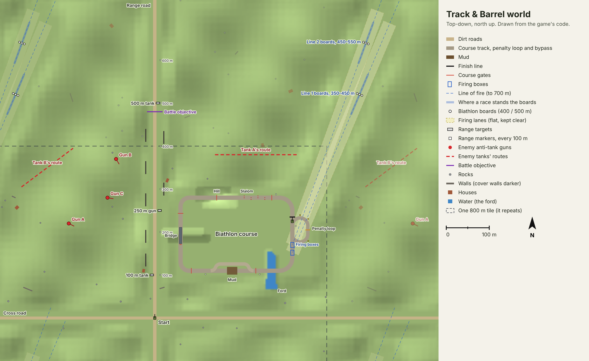

# World map



The whole ground from above, north up, one map pixel a metre. It is drawn from the game's own numbers (`src/sim/terrain.ts`, `range.ts`, `course.ts`, `course-signs.ts`, `enemy-guns.ts`, `enemy-tanks.ts`, `combat.ts`), so it shows what the game builds, not a sketch of it.

**The world repeats.** The ground is one 800 m square tile (dashed) repeated in every direction, so a drive of any length stays on it. The map shows a little more than one tile so the range, the course and the firing lanes each read whole; things beyond the tile's edge are its copies, drawn faded. That is why tank B's route and gun A appear on both sides, and why the biathlon boards, which stand more than 400 m from their boxes, are in the next tile north-east (and, faded, in this tile's south-west corner).

What it shows:

- **The range** ([range.md](range.md)): the start at the crossing of the two dirt roads, the road up the range (north) with its markers every 100 m, and the three targets at 100, 250 and 500 m. The darker walls either side of the road are the Battle scenario's cover ([combat-scenario.md](combat-scenario.md)), and the purple line its objective.
- **The biathlon course** ([biathlon-course.md](biathlon-course.md), [biathlon-driving.md](biathlon-driving.md)): the loop east of the range, driven anticlockwise, with the finish line, gates, slalom, hill, bridge, mud and bypass, ford, and the penalty loop by the firing boxes on the east side. Small squares are its road signs ([biathlon-signs.md](biathlon-signs.md)).
- **The firing lanes** ([biathlon-race.md](biathlon-race.md#lanes-at-1-oclock)): from each firing box to the right front at about 1 o'clock, flat and kept clear of obstacles, with the stretch where a race stands that line's boards and the boards where they stand before any race (400 and 500 m). The dashed line is the line of fire out to 700 m, where a shell over the boards goes.
- **The enemies** ([enemy-guns.md](enemy-guns.md), [enemy-tanks.md](enemy-tanks.md)): the three anti-tank guns left of the range, each with its barrel's direction, and the two enemy tanks' routes.
- **The ground**: lighter slopes face north-west; the flat fields (the start, the roads' corridors, the course and the lanes) are smooth. Rocks, walls and houses are the random obstacles, the same on every page.

## Redrawing it

After moving anything on the ground, run

```
node scripts/draw-map.mjs
```

and commit the new `docs/images/world-map.png` with the change. It bundles `scripts/world-map.ts` (which builds the map's page from the simulation) and renders it in headless Chromium at twice the size, 2,740 × 1,680 px. If Playwright's own Chromium isn't installed, `CHROMIUM_PATH=/path/to/chromium` uses another. `test/world-map.test.ts` keeps the page building as the game's numbers change.
